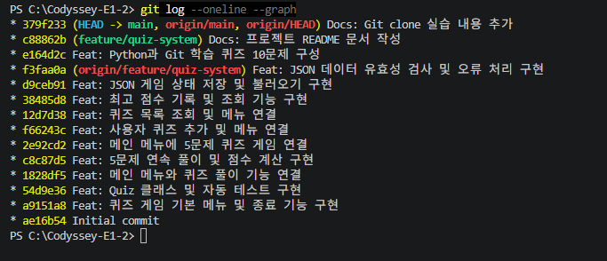
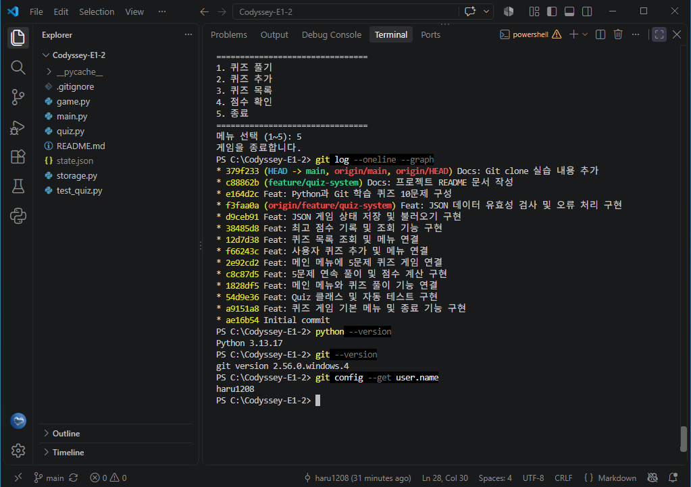
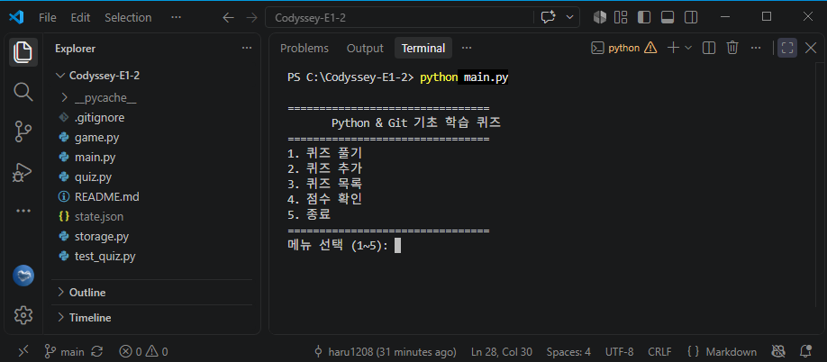
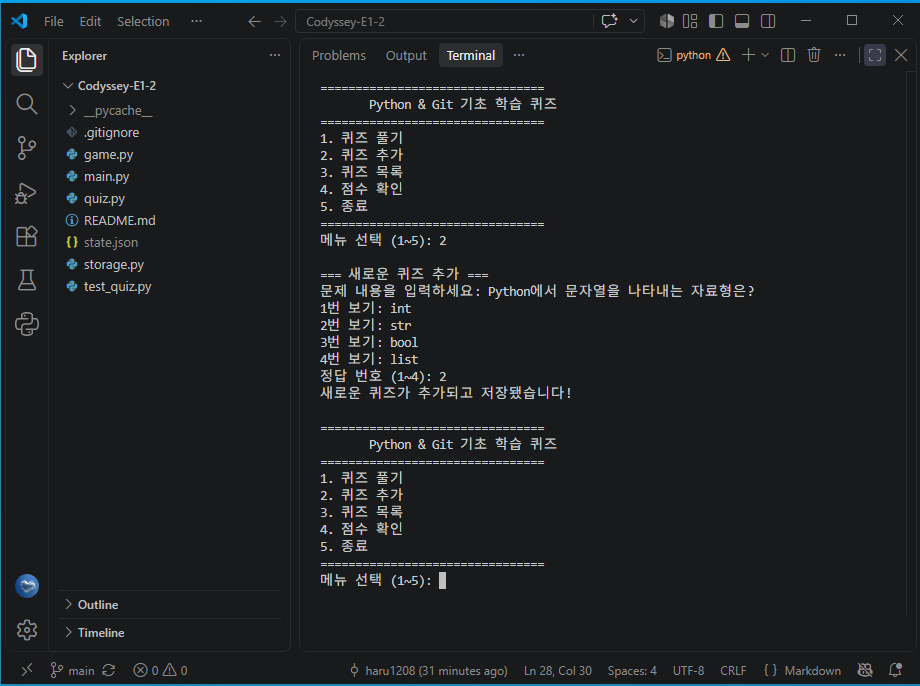
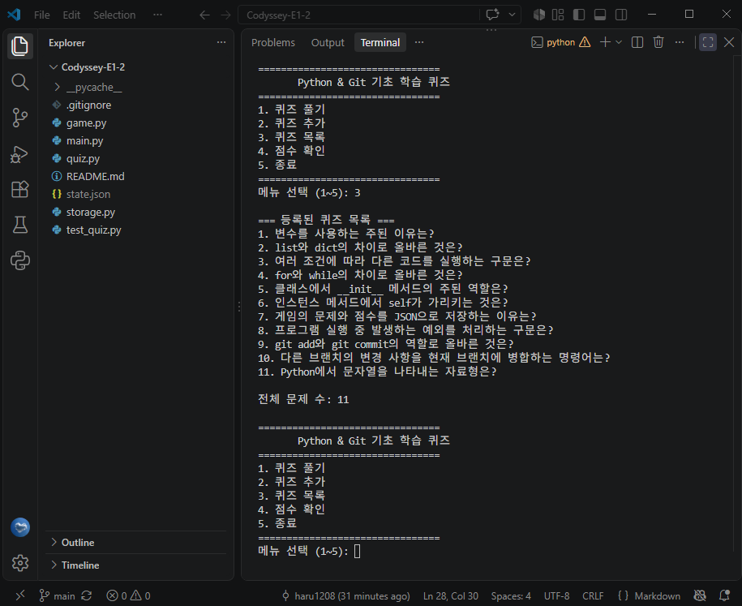
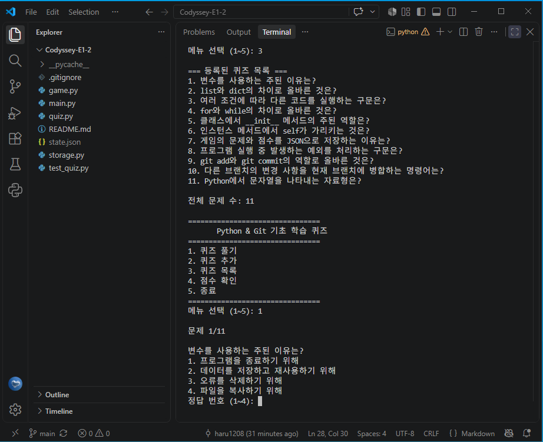
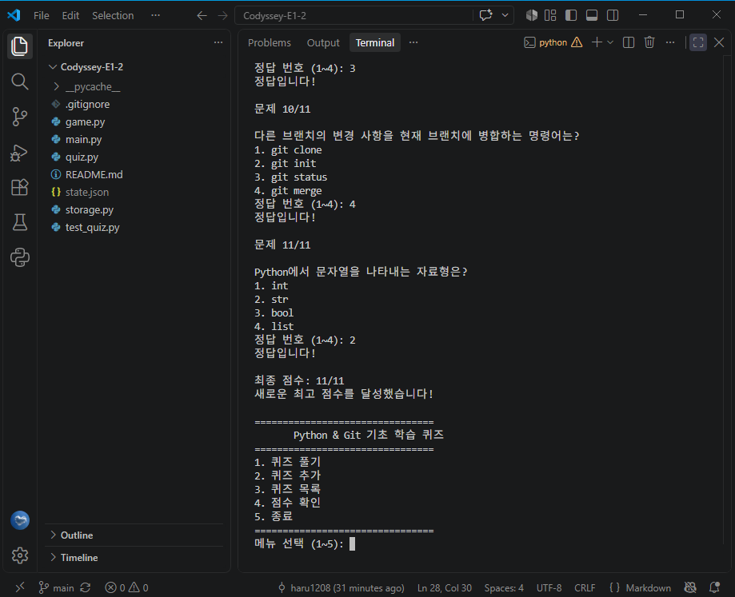

# Python & Git 기초 학습 퀴즈

## 1. 프로젝트 소개

Python과 Git의 기초 개념을 복습하기 위해 제작한 터미널 기반 객관식 퀴즈 게임입니다.

사용자는 퀴즈를 풀거나 새로운 문제를 추가할 수 있으며, 문제 목록과 최고 점수는 JSON 파일에 저장됩니다.

## 2. 주제 선정 이유

코디세이 E1-2 과제에서 학습하는 Python 문법, 클래스, 파일 입출력, Git 명령어의 개념을 퀴즈로 다시 확인하기 위해 주제를 선정했습니다.

게임을 개발하는 과정에서 배운 내용을 실제 문제 풀이를 통해 복습하는 것이 목적입니다.

## 3. 실행 환경 및 방법

- Python 3.10 이상
- 외부 라이브러리 설치 불필요
- Python 표준 라이브러리 사용

실행 명령어: `python main.py`

테스트 명령어: `python test_quiz.py`

## 4. 주요 기능

1. **퀴즈 풀기:** 기본 10문제를 포함한 등록된 퀴즈를 풀고 정답 여부를 확인합니다.
2. **퀴즈 추가:** 문제, 보기 4개, 정답 번호를 입력해 새로운 퀴즈를 등록합니다.
3. **퀴즈 목록:** 현재 등록된 문제와 전체 문제 수를 확인합니다.
4. **점수 확인:** 지금까지 기록한 최고 점수를 확인합니다.
5. **종료:** 프로그램을 안전하게 종료합니다.

## 5. 퀴즈 주제

기본 퀴즈는 총 10문제로 구성되어 있습니다.

- Python 변수와 자료형
- 조건문과 반복문
- 클래스와 객체
- JSON과 예외 처리
- Git 명령어와 브랜치 병합

## 6. 프로젝트 파일 구조

| 파일 | 역할 |
|---|---|
| `main.py` | 프로그램 실행 및 메인 메뉴 |
| `quiz.py` | 개별 퀴즈를 표현하는 Quiz 클래스 |
| `game.py` | 퀴즈 진행과 점수 등을 관리하는 QuizGame 클래스 |
| `storage.py` | JSON 데이터 저장·불러오기 및 검사 |
| `test_quiz.py` | Quiz 클래스 단위 테스트 |
| `README.md` | 프로젝트 설명 문서 |
| `.gitignore` | Git 추적 제외 파일 설정 |
| `state.json` | 실행 중 생성되는 퀴즈 및 점수 기록 |

## 7. 데이터 저장 방식

게임 데이터는 프로젝트 폴더의 `state.json` 파일에 UTF-8 형식으로 저장됩니다.

저장 데이터 예시:

- `quizzes`: 문제 내용, 보기 4개, 정답 번호를 담은 퀴즈 목록
- `high_score`: 지금까지 기록한 최고 점수

프로그램 실행 시 저장 파일이 존재하면 기록을 불러옵니다. 파일이 없으면 기본 문제를 사용합니다.

데이터가 손상된 경우에는 경고 메시지를 출력하고 기본 데이터로 시작하도록 구현했습니다.

`state.json`은 `.gitignore`에 등록되어 GitHub에는 업로드되지 않습니다.

## 8. 사용 기술 및 학습 내용

- Python의 변수, 리스트, 조건문, 반복문, 함수
- 클래스와 객체(`Quiz`, `QuizGame`)
- JSON 파일 입출력
- `try/except`를 통한 오류 처리
- Git 커밋 및 브랜치 기반 버전 관리

## 9. GitHub 저장소

https://github.com/haru1208/Codyssey-E1-2


## 10. Git 복제 실습

이 프로젝트는 GitHub에서 clone한 복제본에서도 수정하고 관리할 수 있습니다.


## 11. 실행 화면 (Screenshots)

기본 퀴즈는 10문제로 구성되어 있습니다.
실행 화면에서는 퀴즈 추가 기능을 테스트하기 위해 1문제를 추가하여 총 11문제를 사용했습니다.

### 1. Git 커밋 기록


### 2. 개발 환경


### 3. 메인 메뉴


### 4. 퀴즈 추가


### 5. 퀴즈 목록


### 6. 퀴즈 풀이


### 7. 점수 확인


## 12. Git 작업 이력 및 실습 증빙

### 커밋 기록

이 프로젝트는 기능별로 변경 사항을 나누어 커밋했습니다.

다음은 프로젝트에서 생성한 주요 커밋 기록입니다.

```text
8e80c53 Docs: expand README for evaluation requirements
61dc658 Docs: add screenshots and update README
379f233 Docs: Git clone 실습 내용 추가
c88862b Docs: 프로젝트 README 문서 작성
e164d2c Feat: Python과 Git 학습 퀴즈 10문제 구성
f3faa0a Feat: JSON 데이터 유효성 검사 및 오류 처리 구현
d9ceb91 Feat: JSON 게임 상태 저장 및 불러오기 구현
38485d8 Feat: 최고 점수 기록 및 조회 기능 구현
12d7d38 Feat: 퀴즈 목록 조회 및 메뉴 연결
f66243c Feat: 사용자 퀴즈 추가 및 메뉴 연결
2e92cd2 Feat: 메인 메뉴에 5문제 퀴즈 게임 연결
c8c87d5 Feat: 5문제 연속 풀이 및 점수 계산 구현
1828df5 Feat: 메인 메뉴와 퀴즈 풀이 기능 연결
54d9e36 Feat: Quiz 클래스 및 자동 테스트 구현
a9151a8 Feat: 퀴즈 게임 기본 메뉴 및 종료 기능 구현
ae16b54 Initial commit
```

아래 목록은 이번 README 수정 이전까지 생성된 커밋 16개를 기록한 것입니다. 이후 추가된 커밋은 다음 명령어로 확인할 수 있습니다

```bash
git log --oneline --graph
```

### 브랜치 분리와 병합

기본 브랜치인 `main`에서 별도의 `feature/quiz-system` 브랜치를 사용하여 퀴즈 기능을 개발했습니다.

브랜치를 분리한 이유는 개발 중인 기능을 기본 브랜치와 구분하고, 기능 완성 후 통합하기 위해서입니다.

개발 완료 후 실행한 명령어:

```bash
git checkout main
git merge feature/quiz-system
```

실제 병합 결과:

```text
Updating a9151a8..c88862b
Fast-forward
7 files changed
```

`Fast-forward`는 별도의 병합 커밋 없이 `main`이 기능 개발 브랜치의 최신 커밋으로 이동한 것을 의미합니다.

브랜치 병합 전에는 대상 브랜치와 변경 내용을 확인하고, 병합 후에는 테스트를 다시 실행하는 것이 중요합니다.

### Clone과 Pull 실습

GitHub 저장소를 다른 폴더로 복제했습니다.

```bash
git clone https://github.com/haru1208/Codyssey-E1-2.git
```

실습에서는 복제본의 README를 수정하고 커밋한 뒤 GitHub로 업로드했습니다.

```bash
git add README.md
git commit -m "Docs: Git clone 실습 내용 추가"
git push origin main
```

복제본에서 생성한 커밋:

```text
379f233 Docs: Git clone 실습 내용 추가
```

이후 원래 프로젝트에서 다음 명령어를 실행했습니다.

```bash
git pull origin main
```

실제 결과:

```text
Updating c88862b..379f233
Fast-forward
README.md | 7 ++++++-
```

이를 통해 복제본에서 수정한 내용이 GitHub를 거쳐 원본 프로젝트에도 반영되는 것을 확인했습니다.

### 커밋 규칙

기능 단위로 변경 사항을 구분하고, 커밋 메시지에 변경 목적을 표시했습니다.

- `Feat:` 새로운 기능 추가
- `Docs:` README 등 문서 수정
- `Fix:` 오류 수정 시 사용할 접두어

가능하면 하나의 커밋에 하나의 주요 변경 목적을 담아 이력을 이해하기 쉽게 관리합니다.

## 13. 프로그램 설계 및 역할 분리

### 클래스 사용 이유

`Quiz` 클래스는 문제, 보기, 정답을 하나의 객체로 묶어 관리합니다.

`QuizGame` 클래스는 여러 퀴즈의 진행, 문제 추가, 목록 조회, 최고 점수 관리를 담당합니다.

클래스를 사용하면 관련 데이터와 기능을 함께 관리할 수 있습니다. 함수만 사용하는 방식으로도 구현할 수 있지만, 여러 문제와 게임 상태를 관리할 때는 클래스 구조가 역할을 구분하는 데 유리합니다.

반면 단순한 프로그램에서는 클래스 사용으로 코드 구조가 복잡해질 수 있습니다.

### 주요 파일과 책임

| 파일 | 주요 함수·메서드 | 역할 |
|---|---|---|
| main.py | main() | 메뉴 출력, 사용자 선택에 따른 기능 호출 |
| quiz.py | __init__(), show(), check_answer() | 퀴즈 데이터 관리, 문제 표시, 정답 판정 |
| game.py | QuizGame.__init__() | 기본 문제 설정과 저장 데이터 로드 |
| game.py | play() | 문제 풀이, 답안 검증, 점수 계산 |
| game.py | add_quiz() | 새 문제 입력 및 저장 |
| game.py | list_quizzes(), show_score() | 문제 목록과 최고 점수 표시 |
| storage.py | load_state(), save_state() | JSON 파일 읽기와 쓰기 |
| storage.py | is_valid_state() | 저장 데이터의 구조 및 값 검사 |

### 입력 검증과 데이터 저장의 분리

사용자가 메뉴나 정답 번호를 입력할 때의 검증은 `main.py`와 `game.py`에서 처리합니다.

반면 `storage.py`는 저장된 JSON 데이터가 올바른 구조인지 검사하고 파일을 읽거나 쓰는 역할을 담당합니다.

이처럼 입력 처리와 파일 저장을 분리하면 기능을 수정하거나 오류를 찾을 때 책임 범위를 구분할 수 있습니다.

## 14. JSON 데이터 구조와 선택 이유

JSON은 데이터를 키와 값으로 표현하는 텍스트 기반 형식입니다.

별도 데이터베이스 서버가 필요하지 않고, 사람이 내용을 읽기 쉬우며 Python 표준 라이브러리로 처리할 수 있어 선택했습니다.

저장 데이터의 예시는 다음과 같습니다.

```json
{
  "quizzes": [
    {
      "question": "Python의 문자열 자료형은?",
      "choices": ["int", "str", "bool", "list"],
      "answer": 2
    }
  ],
  "high_score": 1
}
```

각 필드의 역할은 다음과 같습니다.

- `quizzes`: 등록된 여러 문제를 관리하기 위한 리스트
- `question`: 문제 내용을 저장하는 문자열
- `choices`: 순서가 있는 보기 4개를 저장하는 리스트
- `answer`: 정답 보기 번호를 나타내는 정수
- `high_score`: 지금까지 기록한 최고 점수

각 퀴즈를 딕셔너리 형태로 저장하고, 여러 퀴즈를 리스트에 넣어 문제를 확장하기 쉽게 구성했습니다.

### JSON 저장 방식의 한계

현재 구현은 데이터를 읽을 때 전체 JSON 파일을 불러오고, 저장할 때 전체 내용을 다시 기록합니다.

따라서 문제가 매우 많아지면 메모리 사용량과 파일 읽기·쓰기 시간이 증가할 수 있습니다.

또한 여러 프로그램이 동시에 같은 파일을 수정하면 마지막 저장 내용으로 덮어써질 수 있습니다. 현재는 파일 잠금이나 동시 실행 충돌 방지 기능이 없습니다.

규모가 커지는 경우 Python 표준 라이브러리의 SQLite 등을 대안으로 고려할 수 있습니다.

## 15. 입력 오류와 예외 처리

메뉴에서는 1~5 이외의 입력을 잘못된 값으로 처리합니다.

퀴즈 정답 입력에서는 숫자가 아닌 값과 1~4 범위를 벗어나는 값을 검사하고 다시 입력하도록 안내합니다.

현재 구현은 잘못된 입력 횟수에 제한을 두지 않고, 올바른 값을 입력할 때까지 재시도하도록 설계했습니다.

### 프로그램 중단 처리

`main.py`는 `KeyboardInterrupt`와 `EOFError`를 처리하여 종료 안내 메시지를 출력합니다.

퀴즈 추가가 완료되면 즉시 저장을 시도하고, 퀴즈를 끝까지 풀면 점수와 문제 데이터를 저장합니다.

다만 문제 풀이 도중 Ctrl+C로 종료하면 현재 풀이의 점수는 저장되지 않을 수 있습니다. 종료 시 모든 상황에서 저장이 보장되는 구조는 아닙니다.

### 저장 실패 시 대응

파일에 쓸 수 없는 경우 `save_state()`는 경고 메시지를 출력하고 실패 결과를 반환합니다.

현재 자동 재시도나 임시 파일 저장 기능은 구현되어 있지 않습니다.

저장에 실패하면 파일 권한, 저장 공간, 파일 사용 상태를 확인하고 문제를 해결한 뒤 다시 저장 작업을 수행해야 합니다.

## 16. 데이터 백업 및 복구

현재 프로그램에는 자동 백업 기능이 없습니다.

데이터를 안전하게 보관하려면 프로그램을 종료한 후 `state.json`을 별도로 복사해야 합니다.

Windows PowerShell 백업 예시:

```powershell
Copy-Item .\state.json "$HOME\Codyssey-E1-2-state-backup.json"
```

백업 파일을 복원하려면 프로그램을 종료한 상태에서 다음 명령어를 사용할 수 있습니다.

```powershell
Copy-Item "$HOME\Codyssey-E1-2-state-backup.json" .\state.json
```

복원 명령어는 현재 `state.json`을 덮어쓰므로 실행 전에 기존 파일을 확인해야 합니다.

저장 파일이 손상된 경우 `load_state()`는 경고를 출력하고 기본 문제를 사용합니다.

이 상태에서 새 데이터를 저장하면 손상된 원본 파일을 덮어쓸 수 있으므로, 복구가 필요하다면 먼저 기존 파일을 별도로 백업해야 합니다.

## 17. 기능 변경 시 수정 위치

| 변경하려는 기능 | 주요 수정 위치 |
|---|---|
| 기본 문제 추가·수정 | game.py의 QuizGame.__init__() |
| 문제 출력 형식 변경 | quiz.py의 show() |
| 정답 판정 변경 | quiz.py의 check_answer() |
| 문제 풀이 방식 변경 | game.py의 play() |
| 문제 추가 입력 방식 변경 | game.py의 add_quiz() |
| 메뉴 추가·수정 | main.py의 main() |
| JSON 저장 형식 변경 | storage.py의 save_state(), load_state(), is_valid_state() |
| 최고 점수 처리 변경 | game.py의 play(), show_score() |

기본 문제는 현재 `game.py`의 `QuizGame.__init__()`에 정의되어 있습니다.

기본 문제를 추가하거나 수정할 때는 이 목록을 변경하고 테스트를 실행해야 합니다.

이미 `state.json`이 존재하는 환경에서는 저장된 문제 목록을 우선 불러오므로, 코드에서 기본 문제를 수정하더라도 기존 저장 데이터에는 즉시 반영되지 않을 수 있습니다.


## 18. 프로젝트 완료 점검 및 학습 회고

### 18.1 주요 구현 및 실습 결과

이번 Python & Git 퀴즈 게임 프로젝트에서 다음 작업을 수행했습니다.

- Python을 활용한 터미널 기반 퀴즈 게임 구현
- 퀴즈 풀기, 추가, 목록, 최고 점수 확인, 종료 기능 구현
- Python과 Git을 주제로 한 기본 객관식 퀴즈 10문제 구성
- `Quiz`와 `QuizGame` 클래스를 통한 기능 및 역할 분리
- 조건문, 반복문, 함수, 리스트, 딕셔너리 활용
- JSON 파일을 이용한 퀴즈 데이터와 최고 점수 저장
- 프로그램 종료 후 재실행 시 기존 데이터 복원
- 잘못된 입력과 저장 파일 오류에 대한 예외 처리
- `unittest`를 활용한 단위 테스트 3개 통과
- Git을 이용한 기능별 커밋과 변경 이력 관리
- 기능 개발 브랜치 생성 및 `main` 브랜치 병합
- GitHub 저장소 복제(Clone), 수정 및 Pull 실습
- 실행 화면과 실제 Git 작업 결과를 README에 기록
- 코디세이 AI 사전평가 최종 20/20 PASS 확인

### 18.2 개발 과정에서 발생한 문제와 해결

이번 과제에서는 프로그램의 기능을 구현하는 것뿐 아니라 입력 오류, 데이터 저장, Git 작업 기록을 검증하는 과정도 중요했습니다.

잘못된 메뉴 번호나 정답 번호가 입력되었을 때 프로그램이 종료되지 않도록 입력값을 검사하고 재입력을 안내하도록 구현했습니다.

또한 저장된 JSON 파일이 없거나 손상된 경우에도 기본 퀴즈로 시작할 수 있도록 처리했습니다.

Git 실습에서는 기능 개발 브랜치를 기본 브랜치에 병합하고, 복제한 저장소에서 변경한 내용을 원래 프로젝트에 다시 반영하는 과정을 확인했습니다.

README 작성 과정에서는 스크린샷만으로는 자동 평가에서 실행 과정과 Git 작업 내용을 충분히 확인하기 어려운 부분이 있었습니다.

이를 보완하기 위해 실제 Git 명령어와 출력 결과, 프로그램의 설계 방식, 오류 처리 및 데이터 저장 방식을 문서에 추가했습니다.

그 결과 코디세이 AI 사전평가에서 최종 20/20 PASS를 확인했습니다.

### 18.3 이번 과제를 통해 배운 점

첫 번째 과제에서는 Windows와 Linux 명령어, Docker, Git 등 개발환경과 도구를 사용하는 방법을 실습했습니다.

두 번째 과제에서는 이러한 환경을 활용하여 Python으로 실제 동작하는 프로그램을 구성했습니다.

특히 클래스와 함수를 사용해 기능을 나누고, JSON으로 데이터를 저장하며, 사용자의 잘못된 입력에 대응하는 과정을 경험했습니다.

또한 Git의 커밋, 브랜치, 병합, Clone, Pull이 실제 개발 과정에서 어떤 역할을 하는지 실습했습니다.

프로그램을 완성하는 것과 다른 사람이 구현 과정 및 결과를 확인할 수 있도록 문서화하는 것이 모두 중요하다는 점도 알게 되었습니다.

### 18.4 향후 학습 계획

이번 과제에서는 안내에 따라 코드를 작성하고 실제 실행 결과를 검증하는 데 집중했습니다.

앞으로는 작성한 코드의 각 함수와 클래스가 어떤 역할을 하는지 복습하고, Python의 기본 문법과 JSON 처리 과정을 더 깊이 이해할 계획입니다.

또한 다른 학습자의 실습을 도우면서 Git 명령어와 오류 해결 방법을 다시 설명해 보고, 배운 내용을 스스로 설명할 수 있는 수준으로 발전시키고자 합니다.
