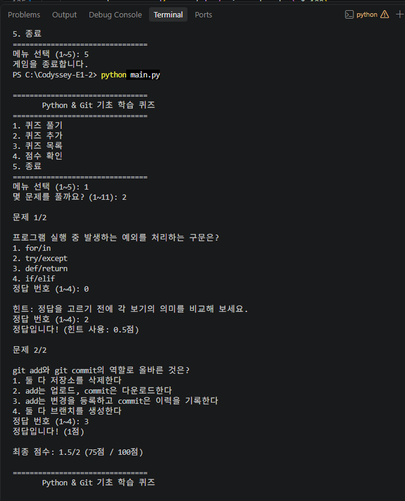
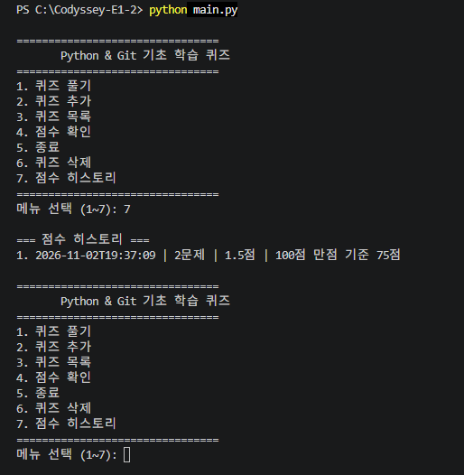
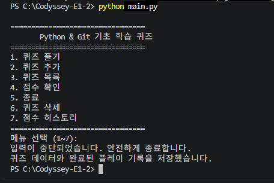

# Codyssey E1-2 | Python & Git 기초 학습 퀴즈 게임

**미션명:** 컴퓨터에게 명령 내리는 말(파이썬) 처음 배우기

## 1. 프로젝트 소개

Python과 Git의 기초 개념을 복습하기 위해 제작한 터미널 기반 객관식 퀴즈 게임입니다.

사용자는 퀴즈를 풀거나 새로운 문제를 추가·삭제할 수 있으며, 문제 목록과 최고 점수, 플레이 기록은 JSON 파일에 저장됩니다. 게임 시작 시 풀이할 문제 수를 선택할 수 있고, 랜덤 출제와 힌트 기능을 제공합니다.

## 2. 주제 선정 이유

코디세이 E1-2 과제에서 학습하는 Python 문법, 클래스, 파일 입출력, Git 명령어의 개념을 퀴즈로 다시 확인하기 위해 주제를 선정했습니다.

게임을 개발하는 과정에서 배운 내용을 실제 문제 풀이를 통해 복습하는 것이 목적입니다.

## 3. 실행 환경 및 방법

- Python 3.10 이상
- 외부 라이브러리 설치 불필요
- Python 표준 라이브러리 사용

프로젝트 폴더에서 프로그램 실행:

```powershell
python main.py
```

기본 단위 테스트 실행:

```powershell
python -m unittest discover -v
```

`state.json`이 없으면 기본 퀴즈 10문제로 시작하며, 프로그램 실행 중 저장 파일이 생성됩니다.

## 4. 주요 기능

1. **퀴즈 풀기:** 등록된 퀴즈를 무작위 순서로 출제하며, 풀이할 문제 수를 선택할 수 있습니다. 정답 여부와 점수를 확인하고, `0`을 입력해 힌트를 확인할 수 있습니다.
2. **퀴즈 추가:** 문제, 보기 4개, 정답 번호를 입력해 새로운 퀴즈를 등록합니다.
3. **퀴즈 목록:** 현재 등록된 문제와 전체 문제 수를 확인합니다.
4. **점수 확인:** 지금까지 기록한 최고 점수를 100점 만점 기준으로 확인합니다.
5. **종료:** 프로그램을 종료합니다.
6. **퀴즈 삭제:** 문제 번호를 선택하고 확인을 거쳐 문제를 삭제합니다. 최소 5문제는 유지합니다.
7. **점수 히스토리:** 플레이 날짜, 풀이한 문제 수, 획득 점수, 환산 점수를 확인합니다.

## 5. 퀴즈 주제

기본 퀴즈는 총 10문제로 구성되어 있습니다.

- Python 변수와 자료형
- 조건문과 반복문
- 클래스와 객체
- JSON과 예외 처리
- Git 명령어와 브랜치 병합

## 6. 프로젝트 파일 구조

| 파일 | 역할 |
|---|---|
| `main.py` | 프로그램 실행 및 메인 메뉴 |
| `quiz.py` | 개별 퀴즈를 표현하는 `Quiz` 클래스, 정답 확인 및 힌트 출력 |
| `game.py` | 퀴즈 진행, 추가·삭제, 점수 및 히스토리 관리용 `QuizGame` 클래스 |
| `storage.py` | JSON 데이터 저장·불러오기 및 유효성 검사 |
| `test_quiz.py` | `Quiz` 클래스 기본 단위 테스트 |
| `README.md` | 프로젝트 설명 문서 |
| `.gitignore` | Git 추적 제외 파일 설정 |
| `state.json` | 실행 중 생성되는 퀴즈, 최고 점수, 플레이 기록 |
| `screenshots/` | 실행 및 실습 화면 증빙 |

## 7. 데이터 저장 방식

게임 데이터는 프로젝트 폴더의 `state.json` 파일에 UTF-8 형식으로 저장됩니다.

주요 데이터는 다음과 같습니다.

- `quizzes`: 문제 내용(`question`), 보기 4개(`choices`), 정답 번호(`answer`), 힌트(`hint`)를 담은 퀴즈 목록
- `high_score`: 100점 만점 기준의 최고 점수
- `history`: 완료한 게임의 날짜·시간, 풀이 문제 수, 획득 점수, 100점 만점 환산 점수 목록

프로그램 실행 시 저장 파일이 존재하고 형식이 유효하면 기록을 불러옵니다. 파일이 없거나 검증에 실패하면 기본 문제와 초기 기록을 사용합니다.

기존 JSON 데이터에 `hint`나 `history`가 없는 경우에도 기본 힌트나 빈 히스토리로 처리할 수 있도록 구현했습니다.

`state.json`은 `.gitignore`에 등록되어 GitHub에 업로드되지 않습니다.

## 8. 사용 기술 및 학습 내용

- Python의 변수, 리스트, 딕셔너리, 조건문, 반복문, 함수
- 클래스와 객체(`Quiz`, `QuizGame`)
- JSON 파일 입출력 및 유효성 검사
- `try/except`를 통한 오류 처리
- `random.shuffle()`을 이용한 문제 순서 섞기
- `datetime`을 이용한 플레이 날짜·시간 기록
- Git 커밋 및 브랜치 기반 버전 관리

## 9. GitHub 저장소

https://github.com/haru1208/Codyssey-E1-2

## 10. Git 복제 실습

이 프로젝트는 GitHub에서 clone한 복제본에서도 수정하고 관리할 수 있습니다.

별도 폴더에 저장소를 복제하고 README를 수정한 뒤 GitHub로 업로드했으며, 원래 작업 폴더에서 pull하여 변경 사항을 반영하는 과정을 실습했습니다.

## 11. 실행 화면 (Screenshots)

기본 퀴즈는 10문제로 구성되어 있습니다. 아래 초기 실행 화면에서는 퀴즈 추가 기능을 테스트하기 위해 1문제를 추가하여 총 11문제를 사용했습니다. 보너스 과제 구현 이후의 화면은 18번에서 별도로 제시합니다.

### Git 커밋 기록


### 개발 환경


### 메인 메뉴


### 퀴즈 추가


### 퀴즈 목록


### 퀴즈 풀이


### 점수 확인


## 12. Git 작업 이력 및 실습 증빙

### 커밋 기록

이 프로젝트는 기능별로 변경 사항을 나누어 커밋했습니다. 다음은 기본 과제 개발 과정에서 생성된 주요 커밋 기록입니다.

```text
8e80c53 Docs: expand README for evaluation requirements
61dc658 Docs: add screenshots and update README
379f233 Docs: Git clone 실습 내용 추가
c88862b Docs: 프로젝트 README 문서 작성
e164d2c Feat: Python과 Git 학습 퀴즈 10문제 구성
f3faa0a Feat: JSON 데이터 유효성 검사 및 오류 처리 구현
d9ceb91 Feat: JSON 게임 상태 저장 및 불러오기 구현
38485d8 Feat: 최고 점수 기록 및 조회 기능 구현
12d7d38 Feat: 퀴즈 목록 조회 및 메뉴 연결
f66243c Feat: 사용자 퀴즈 추가 및 메뉴 연결
2e92cd2 Feat: 메인 메뉴에 5문제 퀴즈 게임 연결
c8c87d5 Feat: 5문제 연속 풀이 및 점수 계산 구현
1828df5 Feat: 메인 메뉴와 퀴즈 풀이 기능 연결
54d9e36 Feat: Quiz 클래스 및 자동 테스트 구현
a9151a8 Feat: 퀴즈 게임 기본 메뉴 및 종료 기능 구현
ae16b54 Initial commit
```

이 목록은 기본 과제 개발 시점의 일부 커밋 기록입니다. 보너스 과제와 README 수정 커밋은 이후에 추가되었습니다. 전체 이력은 다음 명령어로 확인할 수 있습니다.

```bash
git log --oneline --graph
```

### 브랜치 분리와 병합

기본 브랜치인 `main`에서 별도의 `feature/quiz-system` 브랜치를 사용하여 퀴즈 기능을 개발했습니다.

브랜치를 분리한 이유는 개발 중인 기능을 기본 브랜치와 구분하고, 기능 완성 후 통합하기 위해서입니다.

개발 완료 후 실행한 명령어:

```bash
git checkout main
git merge feature/quiz-system
```

실제 병합 결과:

```text
Updating a9151a8..c88862b
Fast-forward
7 files changed
```

`Fast-forward`는 별도의 병합 커밋 없이 `main`이 기능 개발 브랜치의 최신 커밋으로 이동한 것을 의미합니다.

브랜치 병합 전에는 대상 브랜치와 변경 내용을 확인하고, 병합 후에는 테스트를 다시 실행하는 것이 중요합니다.

### Clone과 Pull 실습

GitHub 저장소를 다른 폴더로 복제했습니다.

```bash
git clone https://github.com/haru1208/Codyssey-E1-2.git
```

실습에서는 복제본의 README를 수정하고 커밋한 뒤 GitHub로 업로드했습니다.

```bash
git add README.md
git commit -m "Docs: Git clone 실습 내용 추가"
git push origin main
```

복제본에서 생성한 커밋:

```text
379f233 Docs: Git clone 실습 내용 추가
```

이후 원래 프로젝트에서 다음 명령어를 실행했습니다.

```bash
git pull origin main
```

실제 결과:

```text
Updating c88862b..379f233
Fast-forward
README.md | 7 ++++++-
```

이를 통해 복제본에서 수정한 내용이 GitHub를 거쳐 원본 프로젝트에도 반영되는 것을 확인했습니다.

### 커밋 규칙

기능 단위로 변경 사항을 구분하고, 커밋 메시지에 변경 목적을 표시했습니다.

- `Feat:` 새로운 기능 추가
- `Docs:` README 등 문서 수정
- `Fix:` 오류 수정 시 사용할 접두어

가능하면 하나의 커밋에 하나의 주요 변경 목적을 담아 이력을 이해하기 쉽게 관리합니다.

## 13. 프로그램 설계 및 역할 분리

### 클래스 사용 이유

`Quiz` 클래스는 문제, 보기, 정답, 힌트를 하나의 객체로 묶어 관리합니다.

`QuizGame` 클래스는 여러 퀴즈의 진행, 문제 추가·삭제, 목록 조회, 최고 점수 및 플레이 히스토리 관리를 담당합니다.

클래스를 사용하면 관련 데이터와 기능을 함께 관리할 수 있습니다. 함수만 사용하는 방식으로도 구현할 수 있지만, 여러 문제와 게임 상태를 관리할 때는 클래스 구조가 역할을 구분하는 데 유리합니다.

반면 단순한 프로그램에서는 클래스 사용으로 코드 구조가 복잡해질 수 있습니다.

### 주요 파일과 책임

| 파일 | 주요 함수·메서드 | 역할 |
|---|---|---|
| `main.py` | `main()` | 메뉴 출력, 사용자 선택에 따른 기능 호출 |
| `quiz.py` | `__init__()`, `show()`, `check_answer()`, `show_hint()` | 퀴즈 데이터 관리, 문제 표시, 정답 판정, 힌트 표시 |
| `game.py` | `QuizGame.__init__()` | 기본 문제 설정과 저장 데이터 로드 |
| `game.py` | `play()` | 무작위 출제, 문제 수 선택, 힌트, 점수 계산 및 기록 |
| `game.py` | `add_quiz()`, `delete_quiz()` | 문제 추가·삭제 및 저장 |
| `game.py` | `list_quizzes()`, `show_score()`, `show_history()` | 문제 목록, 최고 점수, 히스토리 표시 |
| `storage.py` | `load_state()`, `save_state()` | JSON 파일 읽기와 쓰기 |
| `storage.py` | `is_valid_state()` | 저장 데이터 구조 및 값 검사 |

### 입력 검증과 데이터 저장의 분리

사용자가 메뉴나 정답 번호를 입력할 때의 검증은 `main.py`와 `game.py`에서 처리합니다.

반면 `storage.py`는 저장된 JSON 데이터가 올바른 구조인지 검사하고 파일을 읽거나 쓰는 역할을 담당합니다.

이처럼 입력 처리와 파일 저장을 분리하면 기능을 수정하거나 오류를 찾을 때 책임 범위를 구분할 수 있습니다.

## 14. JSON 데이터 구조와 선택 이유

JSON은 데이터를 키와 값으로 표현하는 텍스트 기반 형식입니다.

별도 데이터베이스 서버가 필요하지 않고, 사람이 내용을 읽기 쉬우며 Python 표준 라이브러리로 처리할 수 있어 선택했습니다.

현재 보너스 기능까지 반영한 저장 데이터 구조의 **예시**는 다음과 같습니다. 예시의 문제와 기록은 실제 사용자의 저장 데이터를 그대로 복사한 것이 아닙니다.

```json
{
  "quizzes": [
    {
      "question": "Python의 문자열 자료형은?",
      "choices": ["int", "str", "bool", "list"],
      "answer": 2,
      "hint": "정답을 고르기 전에 각 보기의 의미를 비교해 보세요."
    }
  ],
  "high_score": 100,
  "history": [
    {
      "date": "2026-11-02T19:37:09",
      "question_count": 2,
      "score": 1.5,
      "percentage": 75
    }
  ]
}
```

각 필드의 역할은 다음과 같습니다.

- `quizzes`: 등록된 여러 문제를 관리하기 위한 리스트
- `question`: 문제 내용을 저장하는 문자열
- `choices`: 보기 4개를 저장하는 리스트
- `answer`: 정답 보기 번호를 나타내는 정수(1~4)
- `hint`: 힌트 문자열
- `high_score`: 최고 점수(0~100의 정수)
- `history`: 완료한 게임 기록의 리스트
- `date`: 플레이 날짜와 시간을 나타내는 문자열
- `question_count`: 풀이한 문제 수
- `score`: 획득한 원점수(힌트 사용 시 0.5점 가능)
- `percentage`: 100점 만점으로 환산해 반올림한 점수

각 퀴즈를 딕셔너리 형태로 저장하고, 여러 퀴즈를 리스트에 넣어 문제를 확장하기 쉽게 구성했습니다.

### JSON 저장 방식의 한계

현재 구현은 데이터를 읽을 때 전체 JSON 파일을 불러오고, 저장할 때 전체 내용을 다시 기록합니다.

따라서 문제가 매우 많아지면 메모리 사용량과 파일 읽기·쓰기 시간이 증가할 수 있습니다.

또한 여러 프로그램이 동시에 같은 파일을 수정하면 마지막 저장 내용으로 덮어써질 수 있습니다. 현재는 파일 잠금이나 동시 실행 충돌 방지 기능이 없습니다.

규모가 커지는 경우 Python 표준 라이브러리의 SQLite 등을 대안으로 고려할 수 있습니다.

## 15. 입력 오류와 예외 처리

메뉴에서는 `1~7` 이외의 입력을 잘못된 값으로 처리합니다.

퀴즈 정답 입력에서는 숫자가 아닌 값과 `0~4` 범위를 벗어나는 값을 검사하며, `0`은 정답 입력이 아니라 힌트 요청으로 처리합니다. 정답으로는 `1~4`만 허용합니다.

문제 수 선택과 퀴즈 삭제에서도 숫자가 아닌 입력 또는 허용 범위를 벗어나는 입력은 다시 입력하도록 안내합니다.

현재 구현은 잘못된 입력 횟수에 제한을 두지 않고, 올바른 값을 입력할 때까지 재시도하도록 설계했습니다.

### 프로그램 중단 처리

`main.py`는 `KeyboardInterrupt`와 `EOFError`를 처리하여 종료 안내 메시지를 출력합니다.

퀴즈 추가·삭제가 완료되면 저장을 시도하고, 퀴즈를 끝까지 풀면 최고 점수와 플레이 히스토리를 저장합니다.

다만 문제 풀이 도중 `Ctrl+C`로 종료하면 현재 풀이의 점수는 저장되지 않을 수 있습니다. 종료 시 모든 상황에서 저장이 보장되는 구조는 아닙니다.

### 저장 실패 시 대응

파일에 쓸 수 없는 경우 `save_state()`는 경고 메시지를 출력하고 실패 결과를 반환합니다.

문제 추가·삭제 시 저장에 실패하면 메모리의 문제 목록을 이전 상태로 돌리도록 처리했습니다. 플레이 히스토리도 저장 실패 시 방금 추가한 기록을 목록에서 제거합니다.

다만 새 최고 점수를 메모리에 반영한 뒤 저장에 실패하면, 실행 중인 프로그램의 최고 점수와 디스크의 기록이 일시적으로 다를 수 있습니다.

현재 자동 재시도나 임시 파일을 이용한 원자적 저장 기능은 구현되어 있지 않습니다.

저장에 실패하면 파일 권한, 저장 공간, 파일 사용 상태를 확인하고 문제를 해결한 뒤 다시 저장 작업을 수행해야 합니다.

## 16. 데이터 백업 및 복구

현재 프로그램에는 자동 백업 기능이 없습니다.

데이터를 안전하게 보관하려면 프로그램을 종료한 후 `state.json`을 별도로 복사해야 합니다.

Windows PowerShell 백업 예시:

```powershell
Copy-Item .\state.json "$HOME\Codyssey-E1-2-state-backup.json"
```

백업 파일을 복원하려면 프로그램을 종료한 상태에서 다음 명령어를 사용할 수 있습니다.

```powershell
Copy-Item "$HOME\Codyssey-E1-2-state-backup.json" .\state.json
```

복원 명령어는 현재 `state.json`을 덮어쓰므로 실행 전에 기존 파일을 확인해야 합니다.

저장 파일이 손상된 경우 `load_state()`는 경고를 출력하고 기본 문제를 사용합니다.

이 상태에서 새 데이터를 저장하면 손상된 원본 파일을 덮어쓸 수 있으므로, 복구가 필요하다면 먼저 기존 파일을 별도로 백업해야 합니다.

## 17. 기능 변경 시 수정 위치

| 변경하려는 기능 | 주요 수정 위치 |
|---|---|
| 기본 문제 추가·수정 | `game.py`의 `QuizGame.__init__()` |
| 문제 출력 형식 변경 | `quiz.py`의 `show()` |
| 힌트 출력 변경 | `quiz.py`의 `show_hint()`, `game.py`의 `play()` |
| 정답 판정 변경 | `quiz.py`의 `check_answer()` |
| 문제 출제·점수 계산 변경 | `game.py`의 `play()` |
| 문제 추가·삭제 방식 변경 | `game.py`의 `add_quiz()`, `delete_quiz()` |
| 메뉴 추가·수정 | `main.py`의 `main()` |
| 점수 히스토리 조회 변경 | `game.py`의 `show_history()` |
| JSON 저장 형식 변경 | `storage.py`의 `save_state()`, `load_state()`, `is_valid_state()` |
| 최고 점수 처리 변경 | `game.py`의 `play()`, `show_score()` |

기본 문제는 현재 `game.py`의 `QuizGame.__init__()`에 정의되어 있습니다.

기본 문제를 추가하거나 수정할 때는 이 목록을 변경하고 테스트를 실행해야 합니다.

이미 `state.json`이 존재하는 환경에서는 저장된 문제 목록을 우선 불러오므로, 코드에서 기본 문제를 수정하더라도 기존 저장 데이터에는 즉시 반영되지 않을 수 있습니다.

## 18. 보너스 과제 구현 및 검증

기본 과제를 완료한 후 보너스 과제로 제시된 다섯 가지 기능을 추가했습니다.

기존 기능과 저장 데이터를 유지하면서 기능을 확장했으며, `feature/bonus-features` 브랜치에서 개발한 후 `main` 브랜치에 병합했습니다.

### 랜덤 문제 출제

Python 표준 라이브러리 `random`의 `shuffle()`을 활용하여 퀴즈가 무작위 순서로 출제되도록 구현했습니다.

원본 퀴즈 목록을 복사한 뒤 순서를 섞기 때문에 실제 출제 순서가 달라져도 저장된 문제 목록의 순서는 변경되지 않습니다.

### 풀이할 문제 수 선택

사용자가 게임 시작 시 원하는 문제 수를 선택할 수 있도록 구현했습니다.

등록된 전체 문제 수를 기준으로 선택 가능한 범위를 안내하며, 숫자가 아니거나 범위를 벗어난 값이 입력되면 다시 입력하도록 처리했습니다.

문제 수가 달라도 점수를 비교할 수 있도록 최종 결과와 최고 점수를 100점 만점 기준으로 환산했습니다.

### 힌트 기능 및 점수 차감

퀴즈 풀이 중 `0`을 입력하면 힌트를 확인할 수 있도록 구현했습니다.

점수는 다음과 같이 계산합니다.

- 힌트 없이 정답: 1점
- 힌트 사용 후 정답: 0.5점
- 오답: 0점

기존 저장 데이터에 힌트가 없는 경우에는 기본 안내 힌트를 제공하도록 처리했습니다.

실행 테스트에서는 2문제 중 1문제에 힌트를 사용하고, 나머지 1문제는 힌트 없이 정답을 맞혀 다음 결과를 확인했습니다.

```text
최종 점수: 1.5/2 (75점 / 100점)
```



### 퀴즈 삭제 및 JSON 저장

메뉴에 `6. 퀴즈 삭제` 기능을 추가했습니다.

등록된 문제 목록에서 삭제할 문제 번호를 선택한 뒤, `y/n` 입력으로 삭제 여부를 최종 확인하도록 구현했습니다.

삭제가 확인되면 해당 문제를 목록에서 제거하고 JSON 파일에 변경 사항을 저장합니다.

기본 과제의 최소 문제 수 조건을 유지하기 위해 5문제 이하에서는 추가 삭제를 제한했습니다.

실행 테스트에서 기존 11문제 중 1문제를 삭제하여 10문제가 남은 것을 확인했습니다.

이후 프로그램을 종료하고 다시 실행해도 10문제가 유지되어, 삭제 결과가 JSON 파일에 정상적으로 저장되는 것을 확인했습니다.

### 점수 히스토리 저장 및 조회

퀴즈를 완료할 때마다 플레이 기록이 저장되도록 구현했습니다.

JSON 파일의 `history` 목록에는 다음 정보가 저장됩니다.

- 플레이 날짜 및 시간
- 풀이한 문제 수
- 획득 점수
- 100점 만점 환산 점수

최고 점수를 갱신하지 않아도 플레이 기록이 저장되도록 구성했습니다.

메뉴에 `7. 점수 히스토리`를 추가하여 저장된 기록을 조회할 수 있도록 했습니다.

실행 테스트 결과:

```text
=== 점수 히스토리 ===
1. 2026-11-02T19:37:09 | 2문제 | 1.5점 | 100점 만점 기준 75점
```

프로그램을 종료하고 다시 실행한 후에도 동일한 기록이 유지되는 것을 확인했습니다.



### 테스트 및 검증

기존 `Quiz` 클래스의 단위 테스트를 실행했습니다.

실행 명령어:

```powershell
python -m unittest discover -v
```

기존 실행 결과:

```text
test_correct_answer (test_quiz.TestQuiz.test_correct_answer) ... ok
test_quiz_data (test_quiz.TestQuiz.test_quiz_data) ... ok
test_wrong_answer (test_quiz.TestQuiz.test_wrong_answer) ... ok

----------------------------------------------------------------------
Ran 3 tests in 0.001s

OK
```

기존 단위 테스트 3개가 모두 통과했습니다.

보너스 기능은 프로그램을 직접 실행하여 문제 수 선택, 랜덤 출제, 힌트 점수 차감, 퀴즈 삭제, 점수 히스토리 저장 및 조회를 확인했습니다.

단, 위 단위 테스트 3개는 기존 `Quiz` 클래스의 기본 기능을 검사하며, 보너스 기능 전체를 자동으로 검증하는 테스트는 아닙니다.

### 데이터 보존 및 Git 관리

보너스 기능 개발 전에 기존 JSON 데이터의 백업 파일을 생성했습니다.

기존 최고 점수 11점은 11문제를 모두 맞힌 기록을 기준으로 100점 만점 체계로 변환했습니다.

`state.json`과 백업 파일은 `.gitignore`에 등록하여 Git 추적 대상에서 제외했습니다.

보너스 기능 구현 과정에서는 `feature/bonus-features` 브랜치를 사용했습니다.

기능 구현 후 README와 스크린샷을 포함한 변경 사항을 커밋했습니다.

- 작업 브랜치: `feature/bonus-features`
- 커밋 ID: `2e4d912`
- 커밋 메시지: `Feat: implement five quiz bonus features`

해당 브랜치를 GitHub에 업로드한 뒤 `main` 브랜치로 병합했습니다.

병합 후 단위 테스트 3개가 모두 통과했으며, 최종적으로 GitHub의 `main` 브랜치에도 변경 사항을 반영했습니다.

## 19. 프로젝트 최종 회고 및 학습 소감

### 퀴즈 주제 선정 이유

이번 과제에서는 Python과 Git의 기본 개념을 주제로 퀴즈 프로그램을 제작했습니다.

앞선 학습 과정에서 배운 내용을 다시 한번 복습하고, 각 개념을 얼마나 이해하고 있는지 확인해 보고자 해당 주제를 선택했습니다.

단순히 퀴즈 프로그램을 구현하는 데 그치지 않고, 문제와 보기를 구성하면서 Python 문법과 Git 명령어의 의미를 다시 살펴볼 수 있다는 점도 고려했습니다.

또한 직접 만든 프로그램을 실행하고 문제를 풀어보면서 학습 내용과 프로그램의 동작을 함께 확인할 수 있었습니다.

### 개발 과정에서 발생한 문제와 해결

이번 과제에서는 프로그램의 기능을 구현하는 것뿐 아니라 입력 오류, 데이터 저장, Git 작업 기록을 검증하는 과정도 중요했습니다.

잘못된 메뉴 번호나 정답 번호가 입력되었을 때 프로그램이 종료되지 않도록 입력값을 검사하고 재입력을 안내하도록 구현했습니다.

또한 저장된 JSON 파일이 없거나 손상된 경우에도 기본 퀴즈로 시작할 수 있도록 처리했습니다.

보너스 기능을 추가하는 과정에서는 기존 최고 점수 기록을 유지하면서 점수 계산 방식을 변경해야 했습니다.

이를 위해 JSON 파일을 백업하고, 기존 기록을 확인한 후 100점 만점 기준으로 변환했습니다.

힌트 기능과 점수 히스토리를 구현하면서는 코드의 들여쓰기와 중복된 저장 구문을 수정했습니다.

또한 실제 프로그램을 실행하여 힌트 사용에 따른 점수 차감과 플레이 기록 저장 여부를 확인했습니다.

Git 실습에서는 기능 개발 브랜치를 기본 브랜치에 병합하고, 복제한 저장소에서 변경한 내용을 원래 프로젝트에 다시 반영하는 과정을 확인했습니다.

README 작성 과정에서는 스크린샷만으로는 자동 평가에서 실행 과정과 Git 작업 내용을 충분히 확인하기 어려운 부분이 있었습니다.

이를 보완하기 위해 실제 Git 명령어와 출력 결과, 프로그램의 설계 방식, 오류 처리 및 데이터 저장 방식을 문서에 추가했습니다.

그 결과 기본 과제에 대한 코디세이 AI 사전평가에서 20/20 PASS를 확인했습니다.

이후 추가한 보너스 기능은 별도로 구현하고 실행 테스트를 진행했습니다.

### 이번 과제를 통해 배운 점

첫 번째 과제에서는 Windows와 Linux 명령어, Docker, Git 등 개발환경과 도구를 사용하는 방법을 실습했습니다.

두 번째 과제에서는 이러한 환경을 활용하여 Python으로 실제 동작하는 프로그램을 구성했습니다.

특히 클래스와 함수를 사용해 기능을 나누고, JSON으로 데이터를 저장하며, 사용자의 잘못된 입력에 대응하는 과정을 경험했습니다.

보너스 기능 구현을 통해 랜덤 출제, 문제 수 선택, 힌트 기능, 문제 삭제, 플레이 기록 관리 등 기존 프로그램을 단계적으로 확장하는 과정도 경험했습니다.

기능을 추가할 때는 새로운 코드가 작동하는 것뿐 아니라 기존 기능과 저장 데이터에 영향을 주지 않는지도 확인해야 한다는 점을 배웠습니다.

AI의 도움을 받아 코드를 작성하고 실행 결과를 검증하는 과정에서, 제시된 코드를 그대로 사용하는 것뿐 아니라 실제 동작을 확인하는 일이 중요하다는 점을 배웠습니다.

특히 오류가 발생했을 때 원인을 확인하고 수정하는 과정을 통해 프로그램의 구조를 조금씩 이해할 수 있었습니다.

또한 Git의 커밋, 브랜치, 병합, Clone, Pull이 실제 개발 과정에서 어떤 역할을 하는지 실습했습니다.

프로그램을 완성하는 것과 다른 사람이 구현 과정 및 결과를 확인할 수 있도록 문서화하는 것이 모두 중요하다는 점도 알게 되었습니다.

### 향후 학습 계획

이번 과제에서는 안내에 따라 코드를 작성하고 실제 실행 결과를 검증하는 데 집중했습니다.

앞으로는 작성한 코드의 각 함수와 클래스가 어떤 역할을 하는지 복습하고, Python의 기본 문법과 JSON 처리 과정을 더 깊이 이해할 계획입니다.

또한 문제 수 선택, 힌트 점수 차감, 데이터 저장 등 이번에 구현한 기능이 어떤 순서로 동작하는지 스스로 설명할 수 있도록 학습을 이어가고자 합니다.


## 20. 추가 보완 및 최종 검증

### 최고 점수 미기록 상태 개선

퀴즈를 한 번도 풀지 않은 경우와 실제로 0점을 받은 경우를 구분하도록 수정했습니다.

- 플레이 기록이 없고 최고 점수가 0점이면 미응시 안내 출력
- 퀴즈를 완료한 기록이 있으면 최고 점수 출력
- 기존 100점 기록이 유지되는지 확인

### Ctrl+C 및 EOFError 안전 종료 개선

main.py에 try/except/finally 구조를 적용했습니다.

- Ctrl+C 및 EOFError 발생 시 종료 안내 출력
- 정상 종료와 입력 중단 시 데이터 저장 시도
- 저장 성공 또는 실패 여부 안내
- 기존 퀴즈와 완료된 플레이 기록 보존

단, 완료하지 않은 퀴즈의 부분 점수까지 저장하는 기능은 포함하지 않습니다.



### JSON 손상 대응 테스트

기존 state.json을 백업한 뒤 손상된 JSON 파일로 실행 테스트를 진행했습니다.

- JSON 읽기 오류 메시지 출력 확인
- 프로그램 비정상 종료 없이 기본 퀴즈 10문제 실행 확인
- 테스트 후 기존 state.json 복원
- 기존 최고 점수 100점 유지 확인

### Git init 추가 실습

Git 기본 명령어 실습을 보완하기 위해 별도의 폴더에서 Git 저장소 초기화를 진행했습니다.

실행 명령어:

`mkdir C:\Git-Init-Practice`

`cd C:\Git-Init-Practice`

`git init`

기존 프로젝트는 git clone으로 복제했으므로 별도 실습 폴더에서 초기화 과정을 확인했습니다.

### 최종 검증

Python 문법 검사:

`python -m py_compile main.py game.py quiz.py storage.py`

검사 결과 오류 없이 완료되었습니다.

기존 Quiz 클래스 자동 테스트는 다음 명령어로 실행할 수 있습니다.

`python -m unittest discover -v`

이번 보완 작업은 기존 기능과 Git 커밋 이력을 유지하면서 진행했습니다.